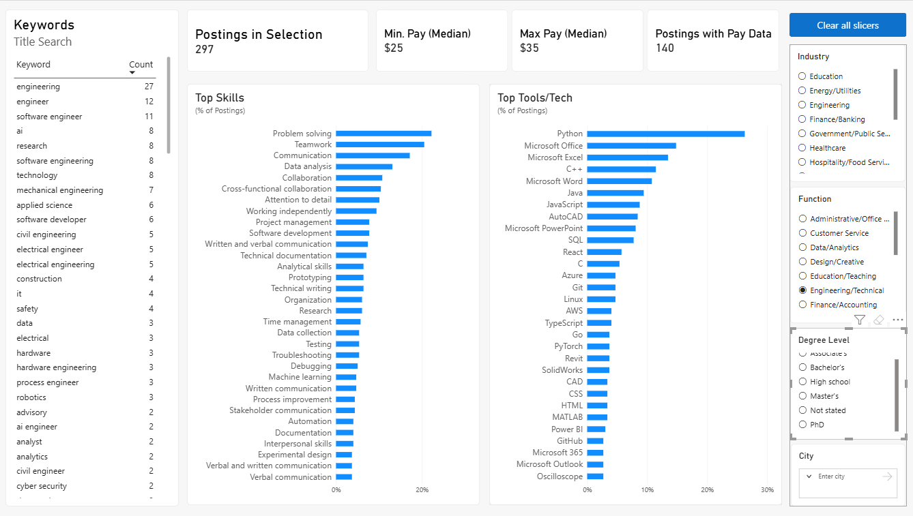

# Internship Skills Discovery Dashboard

This project builds a Power BI dashboard to help job-seekers determine the most important skills for their target industry/function. This version is built on **internship postings**, but the pipeline is not specific to internships and can be adapted to full-time roles (see [Adapting this to full-time roles](#adapting-this-to-full-time-roles)).

To do this, we pull internship postings from the internet, use an LLM to extract skills, pay, and other details from each posting, and aggregate them into one interactive dashboard.



## What the dashboard shows

Filter by **city, industry, function, and degree level**. For the postings you select, it shows:

- **Top skills** (communication, project management, data analysis, etc.) as a percent of the selected postings
- **Top tools and technologies** (Microsoft Excel, Python, AutoCAD, and so on), also as a percent of postings
- **Median hourly pay** (min and max), with the number of postings that actually list pay
- **Title keywords**: the words that appear in the titles of those postings, so students know what to search for on job boards

## Where the data comes from

We pull postings through [SerpApi](https://serpapi.com/)'s Google Jobs API, which returns listings that Google aggregates from many job boards (LinkedIn, Built In, and others).

- **Cities (10):** we search Boston, New York, San Francisco, Chicago, Washington DC, Seattle, Austin, Los Angeles, Atlanta, and Philadelphia (25-mile search radius around each)
- **Queries (3):** we use "internship", "co-op", and "summer 2027 intern". Google Jobs only paginates so deep for one query, so different phrasings surface different postings.
- **Limits:** we take up to 100 postings per city and 1,000 total, with a hard cap on searches per run so the pull stays inside SerpApi's monthly quota. Postings are deduplicated by job ID.

This version uses a snapshot of about 1,000 postings. The pipeline can handle many more: raise `TARGET_TOTAL` and `CITY_CAP`, or add cities and queries, in `01_pull_dataset.py`.

We extract skills with an LLM (Google Gemini) instead of keyword matching, because skills are written in many different ways, and a language model handles that better than rules.

## How it works

We start by pulling postings from SerpApi (step 01). Then we send each posting's description to an LLM and ask it to extract the skills, tools, pay, degree level, and other details (step 02). Next we normalize the results, merging variants like "ms excel" and "Microsoft Excel" into one name (step 03). After that we build two clean CSV tables (step 04), and finally we load them into Power BI.

```
01_pull_dataset.py   SerpApi pull                       -> data/raw_postings.json
02_extract.py        LLM reads each posting             -> data/extracted.jsonl
03_normalize.py      LLM merges variants (unique        -> data/mappings/*.json
                     strings only, in batches)
04_build_tables.py   Pure Python, no API calls          -> data/clean/postings.csv
                                                           data/clean/posting_terms.csv
                                                           data/clean/validation_sample.csv
Power BI             Loads the two CSVs, relates on job_id (dash.pbix)
```

Helpers: `common.py` (shared paths and text cleaning) and `review_mappings.py` (writes `data/mappings/review.txt` so we can check the mappings without opening the JSON files).

| Step | Reads | Writes | Notes |
|---|---|---|---|
| 01 pull | SerpApi | `raw_postings.json`, `pull_progress.json` | The raw postings, with full descriptions. Resumable: finished (city, query) pairs are saved in `pull_progress.json`, so rerunning picks up where it stopped. To pull fresh postings, delete both files first and rerun all steps |
| 02 extract | `raw_postings.json` | `extracted.jsonl` | One Gemini call per posting. Append-only and resumable: rerunning skips finished postings and retries failures |
| 03 normalize | `extracted.jsonl`, `raw_postings.json` | `data/mappings/` | Four mapping files: `tools.json`, `skills.json`, `cities.json`, `title_keywords.json`. Only unique strings are sent, not whole postings. Hand edits are kept on rerun |
| 04 build | raw + extracted + mappings | `data/clean/*.csv` | No API calls. Safe to rerun any time |

### What the LLM extracts from each posting

For each posting, we ask the model to extract:

- **Skills**: general, soft, and domain skills, as short phrases ("project management", "financial modeling", "teamwork")
- **Tools and technologies**: specific named software, languages, and platforms ("Microsoft Excel", "Python", "Salesforce")
- **Industry and function**, from fixed lists
- **Degree level** required, and **compensation** as stated
- Whether the posting is really an internship

We tell the model not to guess. If something isn't stated in the posting, it is left blank.

### Normalization

Raw extraction is messy: "ms excel", "Microsoft Excel" and "excel" are the same tool, and "problem-solving" and "problem solving" are the same skill. In step 03 we send the unique strings to the model in batches and write lookup files that map each variant to one standard name. The mapping files are plain JSON, so we can fix any bad merge by hand, and step 04 applies them.

We count methods and concepts the model listed under tools (machine learning, agile) as skills instead.

### Pay

We convert the stated min and max to hourly separately (no midpoint): yearly ÷ 2,080, monthly × 12 ÷ 2,080, weekly ÷ 40. We exclude flat stipends and treat a stated $0 as no pay. We flag values outside $7.25 to $150 per hour as `out_of_range` and leave them out of the pay figures. We checked those by hand, and they are real oddities, such as commission-based roles quoted per year.

### Title keywords

For each posting title, we ask the model to pull out the role and field words that appear in it ("product manager", "data analyst", "marketing"), dropping "intern", seasons, years, places, and company names. Filtering the dashboard to an industry or function then shows which title words that group of postings uses.

## Data model (Power BI)

- `postings.csv`: one row per posting (title, company, link, city and state, industry, function, degree level, pay fields, `pay_flag`)
- `posting_terms.csv`: long format, one row per posting and term (`job_id`, `type` = skill / tool / title_keyword, `term`, `raw`)
- Related on `job_id`, one to many, filtering from `postings` to `posting_terms` (single direction)

Core measures:

```
Postings with term    = DISTINCTCOUNT(posting_terms[job_id])
Postings in selection = DISTINCTCOUNT(postings[job_id])
% of postings         = DIVIDE([Postings with term], [Postings in selection])
Pay n                 = CALCULATE(COUNTROWS(postings), postings[pay_flag] = "ok")
Median hourly min     = CALCULATE(MEDIAN(postings[pay_hourly_min]), postings[pay_flag] = "ok")
Median hourly max     = CALCULATE(MEDIAN(postings[pay_hourly_max]), postings[pay_flag] = "ok")
```

Each skill, tool, and keyword visual has a visual-level filter on `type`.

## Results and accuracy

- We pulled 1,000 postings and **kept 803** after removing 149 non-internships, 46 duplicate title + company pairs, and 2 test postings.
- **Pay is usable for 347 postings (43%).** Most postings do not list pay.
- **Extraction accuracy:** we hand-checked 10 randomly sampled postings against the live listings. **125 of 135 extracted skills and tools (about 93%) were correct.** Seven of the ten postings had no errors. Most of the errors came from one posting with little description, where the model added skills that were not stated. Ten postings is a small sample, so treat 93% as a rough estimate. We did not measure missed skills (recall), because what counts as a skill is debatable (see Limitations). The scored rows are in `data/clean/validation_checked.csv`.

## Limitations

- **Point-in-time snapshot** from a single pull. There is no trend or time dimension.
- **Pay coverage is 43%**, so pay figures for small selections rest on few postings. The dashboard shows the count (n) and greys out low-n groups.
- **Search bias:** the postings are what Google Jobs returned for three queries in ten cities, not all internships.
- **City counts are capped, not measured.** We capped each city at 100 postings, so the number of postings per city says nothing about which city has more internships. Use the city filter to see what employers there ask for, not to compare demand across cities.
- **"Skill" is a gray area.** It is sometimes hard to say what counts as a skill and what is just something you do in the job. For example, "inventory management" can be a skill a candidate needs, or just a description of the role's day-to-day duties. The model draws that line inconsistently, and a human reviewer would too. This is also why we did not measure recall.
- **LLM output is not perfect.** Normalization can over- or under-merge, and sparse postings can lead the model to add skills that were not stated. The mapping files can be corrected by hand; rerun `04_build_tables.py` afterward.
- **Title keywords are word-level**, so "engineer" and "engineering" appear separately, as employers use both.
- The free-tier Gemini model is rate-limited (about 15 requests per minute), so the full extraction takes a couple of hours.

## Adapting this to full-time roles

The extraction, normalization, tables, and dashboard work on any kind of job posting. Only a few places are internship-specific:

- **Step 01:** change `QUERIES` (for example "analyst" or "software engineer" instead of "internship") and the city list in `01_pull_dataset.py`.
- **Step 02:** the extraction prompt describes the postings as internships and asks the model to flag whether each one is an internship. Reword the prompt and drop or invert that flag.
- **Step 04:** the build script removes postings flagged as not an internship. Remove that filter.
- **Step 03:** the title keyword prompt removes the words "intern" and "co-op". That is harmless for other roles, but it could be extended to remove level words like "senior".

Pay conversion already handles annual salaries, so it works as is. One real gap: full-time postings span many experience levels, and this project only extracts degree level. A full-time version would need an experience-level field (entry, mid, senior) so that students and early-career applicants are not shown senior-role requirements. We have not tested the pipeline on full-time postings.

## Setup and run

Requires Python 3.12.0, Power BI Desktop (free; Windows only), and API keys for SerpApi and Google Gemini.

```bash
python -m venv venv
venv\Scripts\activate          # Windows
pip install -r requirements.txt
```

Create a `.env` file in the project root (it is git-ignored; never commit it):

```
GEMINI_API_KEY=your_gemini_key_here
SERPAPI_KEY=your_serpapi_key_here
```

Run from the project root, in order:

```bash
python python/01_pull_dataset.py
python python/02_extract.py
python python/03_normalize.py            # or: --redo tools skills  to re-ask the model
python python/04_build_tables.py
python python/review_mappings.py         # optional: review the mappings
```

Then open `dash.pbix` in Power BI Desktop and click **Home → Refresh**. (If you moved the project folder, point the two data sources at the new location under **Transform data → Data source settings**.)

To fix a bad merge, edit the file in `data/mappings/` and rerun step 04. Rerunning step 03 keeps your edits.

Step 01 spends SerpApi searches (each result page is one search, retries included), so check your plan's quota before changing `SEARCH_BUDGET`.

## Repository layout

```
python/            pipeline scripts (01 to 04, common.py, review_mappings.py)
data/mappings/     editable normalization lookups
data/clean/        CSVs loaded by Power BI, plus validation_checked.csv
data/extracted.jsonl   LLM extraction output (no posting text)
data/sample_postings.json   a 20-posting sample of the raw data
images/            dashboard screenshot
dash.pbix          the Power BI dashboard
requirements.txt
```

Raw postings are scraped third-party content, so only a small sample is committed. `.env` and the full raw data are in `.gitignore`.
